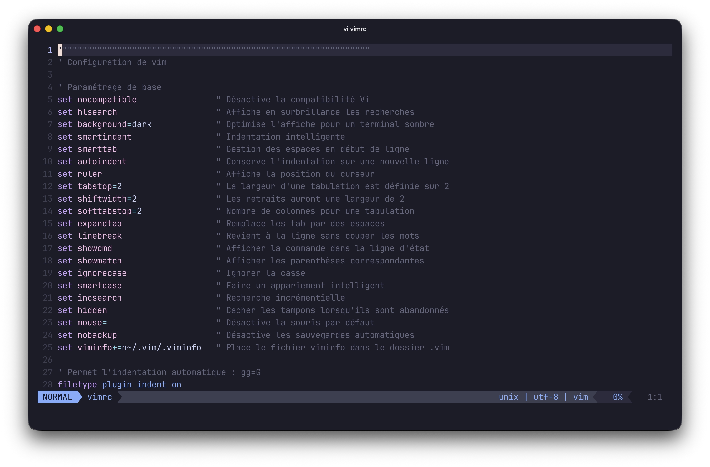

*[Vim](https://fr.wikipedia.org/wiki/Vim) est un éditeur de texte extrêmement personnalisable, que ce soit par l'ajout d'extensions, ou par la modification de son fichier de configuration, écrits dans son propre langage d'extension, le Vim script.*

*Bien qu'il ait de nombreuses fonctionnalités, il conserve un temps de démarrage court (même agrémenté d'extensions) et reste ainsi adapté pour des modifications simples et ponctuelles (de fichiers de configuration par exemple).*

*Vim se différencie de la plupart des autres éditeurs par son fonctionnement modal, hérité de vi. En effet, il possède trois modes de base : le mode normal ou mode commande (dans lequel vous êtes lorsque Vim démarre), le mode insertion, et le mode ligne de commande.*

## Installation de la version Improved

Selon les distributions, la version Improved n'est pas forcément installée. Sur une distribution basée sur Debian :

```sh
sudo apt install vim
```

Une fois Vim installé, la commande vi devient un alias qui pointe vers ce dernier.

## Les commandes de base

Voici un tableau contenant les commandes principales de Vi :

| Commande | Description                                                                       |
| -------- | --------------------------------------------------------------------------------- |
| Esc      | Quitter le mode édition et repasser en mode commande                              |
| i        | Entrer en mode insertion                                                          |
| a        | Entrer en mode insertion après le curseur                                         |
| A        | Entrer en mode insertion à la fin de la ligne                                     |
| D        | Effacer le reste de la ligne à partir du curseur                                  |
| C        | Effacer le reste de la ligne et entrer en mode édition                            |
| cw       | Effacer le mot et entrer en mode édition                                          |
| u        | Annuler la dernière action                                                        |
| :w       | Enregistrer le fichier                                                            |
| :wq      | Enregistrer le fichier et quitter                                                 |
| :q!      | Quitter sans enregistrer les modifications                                        |
| dd       | Supprimer/couper la ligne courante                                                |
| yy       | Copier la ligne courante                                                          |
| p        | Coller sous la ligne courante                                                     |
| P        | Coller avant la ligne courante                                                    |
| w        | Aller au mot suivant                                                              |
| b        | Aller au mot précédent                                                            |
| $        | Aller à la fin de la ligne                                                        |
| 0        | Aller au début de la ligne                                                        |
| gg       | Aller au début du fichier                                                         |
| G        | Aller à la fin du fichier                                                         |
| /        | Suivi d'une saisie d'une chaîne à rechercher                                      |
| n        | Rechercher l'occurrence suivante                                                  |
| N        | Rechercher l'occurrence précédente                                                |
| \*       | Rechercher les occurrences d'une chaîne à la position du curseur. \* pour suivant |

La liste est loin d'être exhaustive, mais vous avez déjà une bonne base pour éditer efficacement.

## Fichier .vimrc

Je vous partage un exemple de configuration pour vim. Ce fichier est à créer sous `~/.vim/vimrc`.

> [!IMPORTANT]
> Ce fichier nécessite la présence de `git` et `curl` sur votre machine (pour le téléchargement de [vim-plug](https://github.com/junegunn/vim-plug) et des plugins)

```vim {filename="~/.vim/vimrc"}
" ─── vimrc ───────────────────────────────────────────────────────────────

" Lancé en tant que 'vi', le vimrc système force 'compatible'
if &compatible | set nocompatible | endif

" Indentation & tabulations
silent! set autoindent          " Conserve l'indentation sur une nouvelle ligne
silent! set tabstop=2           " Largeur d'une tabulation
silent! set shiftwidth=2        " Largeur des retraits
silent! set softtabstop=2       " Nombre de colonnes pour une tabulation
silent! set expandtab           " Remplace les tab par des espaces

" Recherche
silent! set hlsearch            " Affiche en surbrillance les recherches
silent! set incsearch           " Recherche incrémentielle
silent! set ignorecase          " Ignore la casse...
silent! set smartcase           " ...sauf si une majuscule est saisie

" Interface
silent! set ruler               " Affiche la position du curseur
silent! set showcmd             " Affiche la commande en cours
silent! set showmatch           " Affiche les parenthèses correspondantes

" Buffers & navigation
silent! set hidden              " Cache les tampons modifiés lorsqu'ils sont abandonnés
silent! set scrolloff=8         " Lignes de contexte visibles autour du curseur
silent! set splitbelow          " Nouveau split horizontal en dessous
silent! set splitright          " Nouveau split vertical à droite

" Divers
silent! set ttimeout            " Délai d'attente sur les codes de touches
silent! set ttimeoutlen=50      " Supprime le délai perceptible sur Échap
silent! set mouse=              " Désactive la souris par défaut
silent! set nobackup            " Désactive les sauvegardes automatiques
silent! set noswapfile          " Désactive les fichiers d'échange

" Mapping de base
nnoremap <S-Tab> <C-w>w
nnoremap <silent> <CR> :nohlsearch<CR><CR>

" ─── Vim complet uniquement (ignoré par vim.tiny) ────────────────────────
if 1

  " Syntaxe & types de fichiers
  " syntax on
  " filetype plugin indent on

  " Affichage
  silent! set linebreak         " Revient à la ligne sans couper les mots
  silent! set breakindent       " Les lignes coupées conservent leur indentation
  silent! set background=dark   " Optimise l'affichage pour un terminal sombre
  silent! set wildmenu          " Menu de complétion pour la ligne de commande
  silent! set wildoptions=pum   " Menu de complétion en popup vertical (Vim 8.2.4325+)
  silent! set spelllang=en,fr   " Langues de la correction orthographique

  " Caractères invisibles (affichés avec F3)
  let &listchars = "eol:$,space:\u00B7,tab:\u25B8\ ,trail:\u00B7"

  " Forme du curseur selon le mode (insertion, normal, remplacement)
  let &t_SI = "\e[6 q"
  let &t_EI = "\e[2 q"
  let &t_SR = "\e[4 q"

  " Curseur bloc au démarrage, réinitialisé en quittant
  if stridx(&t_ti, "\e[2 q") < 0 | let &t_ti .= "\e[2 q" | endif
  if stridx(&t_te, "\e[0 q") < 0 | let &t_te .= "\e[0 q" | endif

  " ─── fonctions ─────────────────────────────────────────────────────────

  " Bascule les numéros de ligne et la souris dans toutes les fenêtres
  function! ModeIDE()
    let l:on = empty(&mouse)
    let &mouse = l:on ? 'a' : ''
    let &g:number = l:on
    for l:w in getwininfo()
      call setwinvar(l:w.winid, '&number', l:on)
    endfor
    echo 'Mode IDE ' . (l:on ? 'activé' : 'désactivé')
  endfunction

  " Réindentation du fichier sans déplacement du curseur
  function! ReindentFile()
    let l:view = winsaveview()
    keepjumps normal! gg=G
    call winrestview(l:view)
  endfunction

  " ─── mapping ───────────────────────────────────────────────────────────

  " Correcteur orthographique
  nnoremap <F1> <Cmd>set spell!<CR>

  " Mode IDE
  nnoremap <F2> <Cmd>call ModeIDE()<CR>

  " Affichage des caractères invisibles
  nnoremap <F3> <Cmd>set list!<CR>

  " Commentaire
  nmap <F4> gcc
  xmap <F4> gc

  " Indentation automatique
  nnoremap <F5> <Cmd>call ReindentFile()<CR>

  " Gestion des plugins
  nnoremap <F7> <Cmd>PlugClean<CR>
  nnoremap <F8> <Cmd>PlugUpdate<CR>

  " ─── plugins (vim-plug) ────────────────────────────────────────────────

  " Téléchargement de vim-plug si introuvable
  if empty(glob('~/.vim/autoload/plug.vim'))
    silent !curl -fLo ~/.vim/autoload/plug.vim --create-dirs
          \ https://raw.githubusercontent.com/junegunn/vim-plug/master/plug.vim
  endif

  call plug#begin('~/.vim/plugged')

  Plug 'catppuccin/vim', { 'as': 'catppuccin' }
  Plug 'itchyny/lightline.vim'
  Plug 'vim-scripts/VimCompletesMe'

  " Plugin de commentaire natif à partir de Vim 9.1, vim-commentary sinon
  try | packadd! comment | catch | Plug 'tpope/vim-commentary' | endtry

  call plug#end()

  " ─── autocmds ──────────────────────────────────────────────────────────

  augroup vimrc
    autocmd!

    " Mémoriser la dernière position du curseur
    autocmd BufReadPost *
          \ if &ft !~# 'commit' && (line("'\"") > 1) && (line("'\"") <= line("$"))
          \ |   exe "silent! normal! g'\"zO"
          \ | endif

    " Installe les plugins manquants au démarrage, puis recharge
    autocmd VimEnter *
          \ if len(filter(values(g:plugs), '!isdirectory(v:val.dir)'))
          \|  PlugInstall --sync | source $MYVIMRC
          \| endif

    " Pas de prolongation des commentaires (r, o) ni de retour à la ligne auto (c)
    autocmd FileType * setlocal formatoptions-=c formatoptions-=r formatoptions-=o
  augroup END

  " ─── config des plugins (une fois installés) ───────────────────────────

  if isdirectory(expand("~/.vim/plugged"))

    " Thème
    set cursorline
    set termguicolors
    colorscheme catppuccin_mocha

    " Barre de statut
    let g:lightline = {'colorscheme': 'catppuccin_mocha'}
    let g:lightline.separator = { 'left': '', 'right': '' }
    set laststatus=2
    set noshowmode

  endif

endif
```

### Modifications

#### Compatibilité vim.tiny

La première partie du fichier ne contient que des options de base, préfixées par `silent!` pour ne pas générer d'erreur si une option n'est pas supportée. Tout le reste est placé dans un bloc `if 1` : les versions minimales de Vim (comme `vim.tiny` sous Debian), compilées sans le support des expressions, ignorent ce bloc. Le même fichier peut ainsi être utilisé par les deux versions.

#### Plugins

- catppuccin : applique le thème Catppuccin Mocha
- lightline : améliore la barre de statut
- VimCompletesMe : gère l'auto-complétion
- comment : commenter/décommenter rapidement (plugin natif de Vim 9.1+, remplacé par vim-commentary sur les versions antérieures)

#### Mapping

- F1 : active/désactive la correction orthographique (anglais/français)
- F2 : bascule en mode **IDE** : prise en charge de la souris et affichage des numéros de ligne
- F3 : affiche les caractères invisibles (espaces et fins de ligne)
- F4 : commente automatiquement la ligne (s'adapte au type de fichier)
- F5 : effectue une indentation automatique sur l'intégralité du fichier
- F7 : supprime les plugins non utilisés
- F8 : lance une mise à jour des plugins


